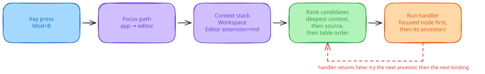

# Overview

`@shaulavo/hotkeys` handles three keyboard tasks: reading held key state, registering shortcut callbacks on a document, and routing commands through a focus tree. One package ships four entrypoints:

- `@shaulavo/hotkeys` for shortcut registration, focus-aware browser and headless dispatch, parsing, validation, formatting, diagnostics, and recording.
- `@shaulavo/hotkeys/react` for React hooks over the document registry, held-key state, and recorders.
- `@shaulavo/hotkeys/terminal` for parsed terminal key events, including legacy escapes and the Kitty keyboard protocol.
- `@shaulavo/hotkeys/adapter` for low-level trie, predicate, chord runtime, and DOM listener helpers used by custom hosts.

## Read keyboard state

Use these hooks from `@shaulavo/hotkeys/react` for held-key indicators and modifier hints:

| Hook                     | Returns                                                                                                            |
| ------------------------ | ------------------------------------------------------------------------------------------------------------------ |
| `useHeldKeys()`          | Currently held normalized key names.                                                                               |
| `useHeldKeyCodes()`      | Map from held key names to their physical `event.code` values.                                                     |
| `useKeyHold('Shift')`    | Whether that key is held, even while other keys are pressed at the same time.                                      |
| `useHotkeyHint('Mod+S')` | Whether the held modifiers match a shortcut's modifiers. Combine this with your action's focus and enabled checks. |

`useKeyHold` is inclusive. Holding Shift and then A keeps `useKeyHold('Shift')` true. Outside React, `getKeyStateTracker()` exposes the shared tracker and its TanStack Store. See [Record shortcuts and track held keys](../packages/hotkeys/docs/api.md#record-shortcuts).

## Register shortcuts

Use `registerHotkey` for a single binding or sequence on the shared document registry, or call `createHotkeyRegistry()` when a view owns its own registry. Call `dispose()` on each registration handle when the owner unmounts.

```ts
import { registerHotkey } from '@shaulavo/hotkeys'

function mountShortcuts(onSave: () => void, onTop: () => void): () => void {
  const save = registerHotkey('Mod+S', onSave)
  const top = registerHotkey(['G', 'G'], onTop, { ignoreInputs: true })

  return () => {
    save.dispose()
    top.dispose()
  }
}

const cleanup = mountShortcuts(
  () => console.log('Save requested'),
  () => window.scrollTo({ top: 0 }),
)
// Call cleanup() when the view unmounts.
```

Within one stroke, `+` joins modifiers to a key, as in `Mod+S` or `Mod++`. `Mod` means Command on macOS and Control on Windows and Linux. Pass an array for a registry sequence, or pass a space-separated chord string such as `'Mod+K Mod+C'` to keymaps and `parseShortcut`.

In React, `@shaulavo/hotkeys/react` binds to the shared document registry and disposes each registration when the component unmounts:

| Job                             | React hook           | Input                                                            |
| ------------------------------- | -------------------- | ---------------------------------------------------------------- |
| One stroke                      | `useHotkey`          | A `HotkeyStroke` such as `'Mod+S'` or `{ key: 'S', mod: true }`. |
| One ordered sequence            | `useHotkeySequence`  | A `HotkeySequence` such as `['G', 'G']`.                         |
| Multiple single-stroke bindings | `useHotkeys`         | Array of `{ hotkey, callback, options? }` definitions.           |
| Multiple sequence bindings      | `useHotkeySequences` | Array of `{ sequence, callback, options? }` definitions.         |

`HotkeysProvider` supplies default options for those hooks. Batch options apply in this order: provider defaults, common options, then per-definition options. See the [React API reference](../packages/hotkeys/docs/api.md#react) for targets, enabled state, batch rollback, and server rendering.

## Build editor keymaps

Use a dispatcher when the same key triggers different commands depending on focus. The [getting-started guide](getting-started.md#route-one-shortcut-by-focus) shows a complete browser example where `Mod+B` toggles a sidebar in the workspace and toggles bold text in an editor.

`createBrowserDispatcher` attaches focus nodes to DOM elements. Each node defines a context and command handlers, and a `parent` link connects it to enclosing panes. When a key arrives, the dispatcher resolves it against that focus path and runs the first handler that accepts the command. Call `dispose()` when the view unmounts.

For non-DOM hosts, call `createDispatcher` from `@shaulavo/hotkeys` and pass your own `KeyInput` events. For terminal apps, call `createTerminalDispatcher` from `@shaulavo/hotkeys/terminal`.

```ts
import { createTerminalDispatcher } from '@shaulavo/hotkeys/terminal'
import type { TerminalKeyLike } from '@shaulavo/hotkeys/terminal'

const dispatcher = createTerminalDispatcher<TerminalKeyLike, { 'settings.open': void }>({
  platform: 'linux',
  keymap: [{ keys: 'Control+K S', command: 'settings.open' }],
})
const root = dispatcher.createNode({
  commands: { 'settings.open': () => console.log('Open settings') },
})
root.focus()

const report = dispatcher.explain('Control+K S')
console.log(report.active.length)
dispatcher.dispose()
```

<picture>
  <source media="(prefers-color-scheme: dark)" srcset="assets/key-resolution.dark.svg">
  
</picture>

Read the detailed guides for exact rules:

- [The focus tree](../packages/hotkeys/docs/concepts.md#the-focus-tree) explains focus nodes, DOM attachment, and hosted widgets.
- [Ranking and user overrides](../packages/hotkeys/docs/keymaps.md#ranking) explain tie breaking, `unbind`, `command: null`, and `dispatcher.explain`.
- [Chords](../packages/hotkeys/docs/keymaps.md#chords) cover pending prefixes, timeouts, prefix ordering, and text replay.
- [Terminals](../packages/hotkeys/docs/keymaps.md#terminals) cover `createTerminalDispatcher` and terminal key normalization.
- [Parse, match, and format](../packages/hotkeys/docs/api.md#parse-match-and-format) and [Record shortcuts](../packages/hotkeys/docs/api.md#record-shortcuts) cover shortcut validation, display labels, and settings UIs.

Version 0.0.x APIs can change between releases. The [performance notes](../packages/hotkeys/docs/performance.md) record timings for a 255-binding table. Run `bun bench/lookup.ts` from `packages/hotkeys` to measure on your machine.
