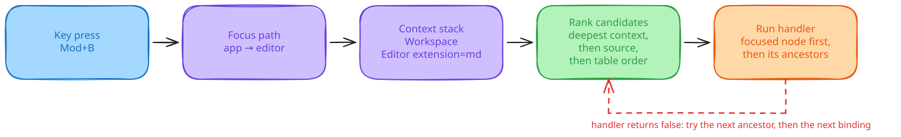

# Overview

Bind keys to commands and choose the binding that matches what has focus. Your app supplies the keymap, including bindings in the style of VS Code, Zed, or another editor. A DOM-free core handles contexts, chords, and user overrides, with browser and terminal adapters. Context predicates and chord dispatch follow Zed's model.

## One key, two jobs

`Mod+B` can bold text in the editor and toggle a sidebar elsewhere. The dispatcher picks a binding from what has focus, and the deepest matching context runs first.

```ts
import { createBrowserDispatcher } from '@fregat/hotkeys'

const keys = createBrowserDispatcher({
  keymap: [
    { keys: 'Mod+B', command: 'sidebar.toggle' },
    { keys: 'Mod+B', command: 'text.bold', context: 'Editor' },
  ],
})
const app = keys.createNode({ commands: { 'sidebar.toggle': () => {} } })
const editor = keys.createNode({
  parent: app,
  context: 'Editor',
  commands: { 'text.bold': () => {} },
})
keys.attachElement(app, document.body)
keys.attachElement(editor, document.getElementById('editor')!)
```

<picture>
  <source media="(prefers-color-scheme: dark)" srcset="assets/key-resolution.dark.svg">
  
</picture>

## Capabilities

- Context predicates match expressions such as `Workspace > !Terminal` against a focus tree.
- User overrides layer user, pack, base, and default bindings. Users can remove a pack's binding or claim a key. See [keymap rules](../packages/hotkeys/docs/keymaps.md).
- Chords support sequences such as `Mod+K Mod+C`, with pending prefixes and replay after a mismatch.
- Browser and terminal adapters accept DOM keyboard events, terminal escapes, and Kitty keyboard input.
- Display and recording APIs format platform-specific labels and record new shortcuts. [React hooks](../packages/react-hotkeys/README.md) tie registrations to a component's lifetime.

Version 0.0.x APIs can change between releases. The [lookup benchmark](../packages/hotkeys/docs/performance.md) times a 255-binding table. Run `bun bench/lookup.ts` from `packages/hotkeys`; its timings describe that machine and run.
