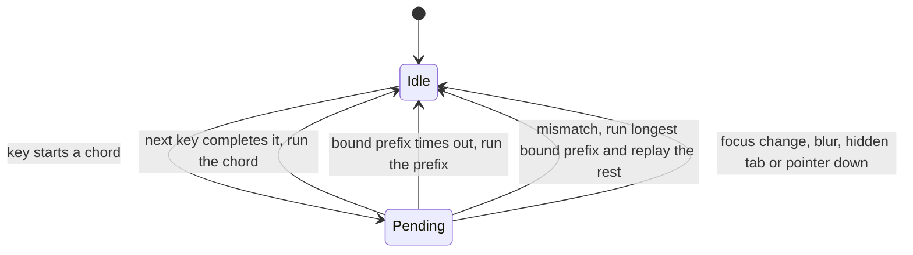

# Concepts

Hotkeys resolves keyboard input through four parts: a focus tree, a context stack, a chord trie, and one ranking rule. Read this page for the mental model, then see [Keymaps](keymaps.md) for the exact resolution rules.

## The short version

<picture>
  <source media="(prefers-color-scheme: dark)" srcset="../../../docs/assets/key-resolution.dark.svg">
  
</picture>

A dispatcher does not scan a flat global list of shortcuts. Each key press starts at the focused node, and that node's ancestor path determines which bindings can match. That is how `Mod+B` toggles bold text inside an editor and toggles a sidebar everywhere else in the workspace.

## The focus tree

A focus node represents a region that can hold focus, such as a workspace, an editor, or a terminal pane. Nodes connect through `parent`, and each node carries a context and command handlers.

```ts
const hotkeys = createBrowserDispatcher({ keymap })
const workspace = hotkeys.createNode({
  context: 'Workspace',
  commands: { 'sidebar.toggle': toggleSidebar },
})
const editor = hotkeys.createNode({
  parent: workspace,
  context: 'Editor',
  commands: { 'text.bold': bold },
})
```

In a browser, tie nodes to DOM elements with `attachElement(node, element)`. When a keydown event fires, the dispatcher walks the event's composed path, finds the closest attached element, and focuses the deepest node attached to that element. Clicking or tabbing into a pane moves dispatcher focus automatically. Outside a browser, call `node.focus()` directly. Removing the focused node or one of its ancestors moves focus to the nearest live parent.

When an application embeds an independent widget such as a terminal or code editor, call `hotkeys.asHosted()` and pass the enclosing node as a `HostedFocusNode` parent. The widget attaches its own child nodes into the same focus tree while the host keeps its typed command map intact.

## The context stack

The contexts of the nodes from the outermost ancestor down to the focused node form the context stack. Nodes with an empty context add no entry. Call `dispatcher.contextStack()` to inspect the current stack at any time.

A binding's `context` field is a predicate evaluated against that stack, using Zed's syntax: `Workspace > !Terminal` or `Editor && extension == md`. A binding without `context` matches every focus stack.

## Ranking

When multiple bindings match a key, the dispatcher sorts candidates by:

1. Deepest context matched by `context`.
2. Binding source: `user`, then `pack`, then `base`, then `default`.
3. Table order, with later entries winning ties.

The full rules and override examples live in [Ranking](keymaps.md#ranking).

If a command handler returns `false`, it declines the command. The dispatcher tries the next ancestor node for the same command, then moves to the next candidate binding. If no handler accepts the key, the browser or host runs its default behavior.

## Printed keys and physical keys

Logical bindings match the printed character. `?` matches a `?` whether or not the layout requires Shift to type it. `Control++` matches Control with a printed `+`. This implicit-Shift rule applies to single-code-point non-letter glyphs, including digits, at any stroke in a chord. Letters and named keys always require exact Shift matching: `A` does not match `Shift+A`, and `Enter` does not match `Shift+Enter`. Writing `Shift+?` requires Shift explicitly.

Physical bindings use bracketed `event.code` tokens such as `[Slash]` and `Control+[KeyE]`. Physical bindings always require exact modifiers. `Shift+Slash` requires `Shift+[Slash]` even when it prints `?`. Input events and recorded shortcuts keep their actual modifiers. Implicit Shift affects logical matching alone.

For each stroke, the dispatcher tries matching edges in priority order:

1. Exact printed-key match.
2. Exact physical-code match.
3. Printed-glyph match allowing implicit Shift.
4. Positional fallback with the original modifiers.

Exact `Shift+?` and `Shift+[Slash]` therefore win over permissive `?`. If a higher-priority edge has only bindings that are ineligible for the current context or `isAvailable` check, lookup continues to the next matching edge so an inactive `Terminal` binding on logical `Control+A` cannot block an active `Editor` binding on physical `Control+[KeyQ]`.

Latin letters keep their printed meaning on letter keys, including accented characters: pressing Control with `é` on `KeyE` does not trigger logical `Control+E`. Bind `Control+[KeyE]` when you want that physical key position. Alt compatibility fallback for transformed glyphs remains available, but AltGraph's synthetic Control+Alt does not trigger logical shortcuts. Non-Latin layouts and dead keys can still use positional fallback.

## Chords

Space-separated strokes such as `Mod+K Mod+C` form chords. Compiling a keymap builds one trie over every bound sequence, and the dispatcher holds a chord pending while at least one eligible longer binding remains reachable.



A pending chord belongs to the focus under which it started and cancels if focus moves. Subscribe with `dispatcher.subscribePending(listener)` or pass `onPendingChange` to display a pending chord hint, and pass `onSequence` to observe how each chord ends.

## Layers

Hotkeys exposes three main layers plus two specialized subpaths. Pick the narrowest one your app needs:

- `registerHotkey` and `getHotkeyRegistry()` for document-level callbacks such as `Mod+S`. The newest registration for a key runs first, and `conflictBehavior` controls collisions.
- `createBrowserDispatcher()` for focus-aware browser apps. It adds focus nodes, contexts, typed command maps, user overrides, diagnostics via `explain()`, and DOM listeners.
- `createDispatcher()` for DOM-free hosts that supply their own `KeyInput` events and focus calls.
- `@shaulavo/hotkeys/terminal` for parsed terminal input (`createTerminalDispatcher`).
- `@shaulavo/hotkeys/adapter` for custom runtimes that assemble `createChordRuntime`, `buildKeymapTrie`, and `attachKeyListeners` directly.

Every stateful handle and runtime (`HotkeyRegistration`, `HotkeyRegistry`, `Dispatcher`, `BrowserDispatcher`, `TerminalDispatcher`, `HotkeyRecorder`, `HotkeySequenceRecorder`, and `KeyStateTracker`) tears down with `.dispose()` and supports `[Symbol.dispose]()`.

The registry and the dispatcher resolve shared keys differently. In the registry, the newest registration for a key runs first, and returning `false` falls through to older registrations. Because the registry has no focus tree, two registrations of `Mod+B` on one target count as a conflict. When one key must perform different actions in different panes, use a dispatcher with focus contexts. Text input filtering also differs by layer: the registry uses `ignoreInputs`, while a dispatcher uses focus contexts. See [It works outside inputs but not inside](troubleshooting.md#it-works-outside-inputs-but-not-inside).

## Where to go next

- [Keymaps](keymaps.md) covers predicate syntax, ranking, unbinding, `explain()`, chord rules, and terminals.
- [Troubleshooting](troubleshooting.md) diagnoses shortcuts that fail to fire or behave unexpectedly.
- [API reference](api.md) documents every export across all four entrypoints.
