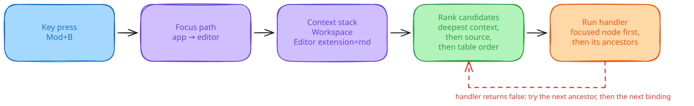

# Concepts

This page explains how `@shaulavo/hotkeys` resolves keys, normalizes shortcuts, separates focus dispatch from registry shortcuts, tracks held keys, and runs multi-stroke chords.

## Key resolution

Every keyboard event enters the matcher as a `KeyInput` with a normalized logical `key`, an optional physical `code`, a 4-bit modifier set (`alt`, `ctrl`, `meta`, `shift`), and an `altGraph` flag.

<picture>
  <source media="(prefers-color-scheme: dark)" srcset="../../../docs/assets/key-resolution.dark.svg" />
  <source media="(prefers-color-scheme: light)" srcset="../../../docs/assets/key-resolution.light.svg" />
  
</picture>

`trieStep` evaluates candidate edges in four steps, stopping at the first edge accepted by the active context and availability filter:

1. **Exact logical match:** `input.key` with the exact modifier mask. When `altGraph` is true (Windows and Linux AltGr), synthetic `Control+Alt` is stripped so the produced glyph matches directly.
2. **Exact physical match:** `[${input.code}]` with the exact modifier mask. Physical bindings match key position on every keyboard layout.
3. **Implicit Shift on a printed glyph:** when `Shift` is held and `input.key` is a printed symbol such as `?` or `+`, the matcher also checks the unshifted binding edge so `{ keys: '?' }` matches `Shift+Slash`.
4. **Positional fallback:** for `Alt` or dead-key combinations where `event.key` produces an accented character or `'Dead'` (common with macOS `Option` chords), the matcher falls back to the US layout letter, digit, or punctuation name derived from `input.code` while keeping exact modifiers.

Because `trieStep` takes an `accepts` predicate, an ineligible binding on a higher-priority edge (for example, a `Terminal`-only logical `Control+A` binding while focus is in `Editor`) never blocks an eligible binding on a lower-priority edge (such as an `Editor` physical `Control+[KeyQ]` binding on an AZERTY keyboard). Live dispatch and `dispatcher.explain()` follow the same edge order.

## Logical keys vs physical codes

A shortcut stroke matches either a logical key or a physical `KeyboardEvent.code`, never both:

- **Logical keys** (`'Mod+S'`, `'?'`, `{ key: 'S', mod: true }`) follow the user's active keyboard layout. Use logical keys for mnemonic commands such as Save or Find.
- **Physical codes** (`'Mod+[KeyS]'`, `'Control+[Digit1]'`, `{ code: 'KeyQ', ctrl: true }`) match physical key position regardless of layout. Use physical codes for positional controls (such as directional keys or number-row tabs) or when recording layout-independent shortcuts.

`parseHotkey(event, platform)` always returns a logical `ParsedHotkey` without `code`, and `areHotkeysEqual` keeps physical and logical strokes distinct even when one event could match both.

## `Mod` and the three normalization modes

`Mod` represents the platform's primary shortcut modifier: `Meta` (Command) on `'mac'`, and `Control` on `'windows'` and `'linux'`.

`normalizeHotkey(input, { mode, platform })` makes modifier conversion explicit instead of guessing:

- **`'symbolic'` (default):** keeps `Mod`, `Control`, and `Meta` as written. `'Control+S'` stays `'Control+S'` on Linux, and `'Mod+S'` stays `'Mod+S'`. Use `'symbolic'` when storing user settings.
- **`'resolved'`:** resolves `Mod` for `platform` (`'Mod+S'` becomes `'Control+S'` on Linux and `'Meta+S'` on macOS). Use `'resolved'` for platform equivalence checks, `CompiledBinding.chord`, and pending chord labels.
- **`'adaptive'`:** folds the platform's primary literal modifier (`Meta` on macOS, `Control` on Windows and Linux) into `'Mod'` when the other primary modifier is absent. Use `'adaptive'` when turning recorded literal events into portable cross-platform shortcuts.

`HotkeyRecorder` and `HotkeySequenceRecorder` default to `modifierMode: 'adaptive'` and `recordBy: 'code'`, and both can be switched to `'literal'` or `'key'`.

## Pipeline ownership: focus tree vs hotkey registry

`@shaulavo/hotkeys` provides two distinct pipelines:

- **Focus tree (`BrowserDispatcher` and `Dispatcher`):** declarative `KeymapEntry[]` tables routed through a tree of `FocusNode` instances with context predicates, source ranks, unbinding, and command handlers.
- **Document registry (`HotkeyRegistry` and `registerHotkey`):** imperative callback bindings scoped to a document or element target. Internally, `HotkeyRegistry` owns a private `BrowserDispatcher` whose `isAvailable` filter only accepts registry entry IDs and whose keymap is rebuilt lazily on the next key event.

In React, `HotkeysProvider` never mixes the two:

- `FocusScope`, `useFocusNode`, `useHotkeysDispatcher`, and `usePendingChord` attach to the provider's focus dispatcher (`dispatcher` or `keymap` prop).
- `useHotkey`, `useHotkeySequence`, `useHotkeys`, and `useHotkeyRegistrations` attach to `props.registry ?? getHotkeyRegistry()`.
- Multiple `useFocusNode` calls on the same `(element, parent)` for one dispatcher share a single element-attached group node, merge their contexts on capture, and remove their handlers independently. Detaching the last registration removes the group node.

## Chords and pending labels

Multi-stroke bindings (such as `'Mod+K Mod+C'` or `['G', 'G']`) are stored in a stroke trie. When a stroke has reachable continuations (`selection.pending > 0`), the runtime swallows the stroke, buffers it, and publishes a `PendingChordLabel`:

```ts
type PendingChordLabel = {
  readonly keys: string
  readonly candidateCount: number
}
```

- `keys` is the space-separated sequence of platform-resolved stroke strings (from `normalizeHotkey(parsed, { mode: 'resolved', platform })`), such as `'Control+K'` on Linux or `'Meta+K'` on macOS. Pass `pending.keys` to `formatForDisplay` when rendering a UI badge.
- `candidateCount` is the count of descendant trie nodes that have at least one reachable continuation binding.
- `dispatcher.pending()` returns a frozen object whose reference stays identical (`Object.is`) until the pending state changes.
- `dispatcher.subscribePending(listener)` notifies subscribers on each transition. If a listener synchronously cancels, completes, or replaces the pending chord, the runtime stops the stale outer notification loop immediately so later listeners never observe an obsolete label after `null`.

### Timeout and replay rules

- **Timeout (`timeoutMs`, default `1000` ms):** starts only when the buffered prefix is itself bound or when the focused target accepts text input (`acceptsTextInput`). An unbound non-text prefix such as `'Control+K'` waits indefinitely until the next key, window blur, hidden tab, pointer down, focus move, or `cancel()`.
- **Mismatch and timeout replay:** if the next stroke does not match any continuation (or a timed prefix expires), the runtime runs the longest bound prefix in the buffer or forwards unclaimed buffered keys to `replay` (in browsers, `replayTextInput` inserts printable characters back into the text field). If focus moved before expiry, the pending chord ends as `'superseded'` without replaying into the new target.
- **While pending:** `keyup`, modifier-only keys, and `repeat` keydowns are swallowed without ending the pending chord.

## `KeyStateTracker` singleton lifetime and recovery

`getKeyStateTracker()` and `KeyStateTracker.getInstance()` share one singleton tracker per browser environment.

- **Listeners:** on creation in a browser, the tracker attaches capture-phase `keydown` and `keyup` listeners on `window` (so it sees keys before document dispatchers consume them), `blur` on `window`, and `visibilitychange` on `document`.
- **State:** `tracker.store.state` holds `heldKeys` (unique normalized logical names), `heldCodes` (latest `event.code` per logical name), and `activeCodes` (every currently held physical `event.code`).
- **Multi-side physical keys:** `heldCodes['Shift']` can hold only one value, so holding both `ShiftLeft` and `ShiftRight` records both codes in `activeCodes`. `isKeyHeld('[ShiftLeft]')` and `useKeyHold('[ShiftLeft]')` read `activeCodes`, keeping left and right keys independently observable until each side releases.
- **Automatic recovery:** releasing any modifier key clears all non-modifier keys from the held set, preventing stuck keys when macOS intercepts chords like `Cmd+S` and omits the non-modifier `keyup`. Window `blur` and `document.visibilityState === 'hidden'` call `reset()`.
- **Manual recovery:** call `tracker.reset()` if your app detects an external source of dropped keyups such as paste automation or dictation software.
- **React and teardown:** `useHeldKeys`, `useHeldKeyCodes`, `useKeyHold`, and `useHotkeyHint` acquire the singleton only after client commit (returning empty values or `false` during SSR) and unsubscribe on unmount without disposing the shared singleton. Call `tracker.dispose()` (or `KeyStateTracker.resetInstance()` in tests) to remove listeners, clear state, and clear the singleton slot.
